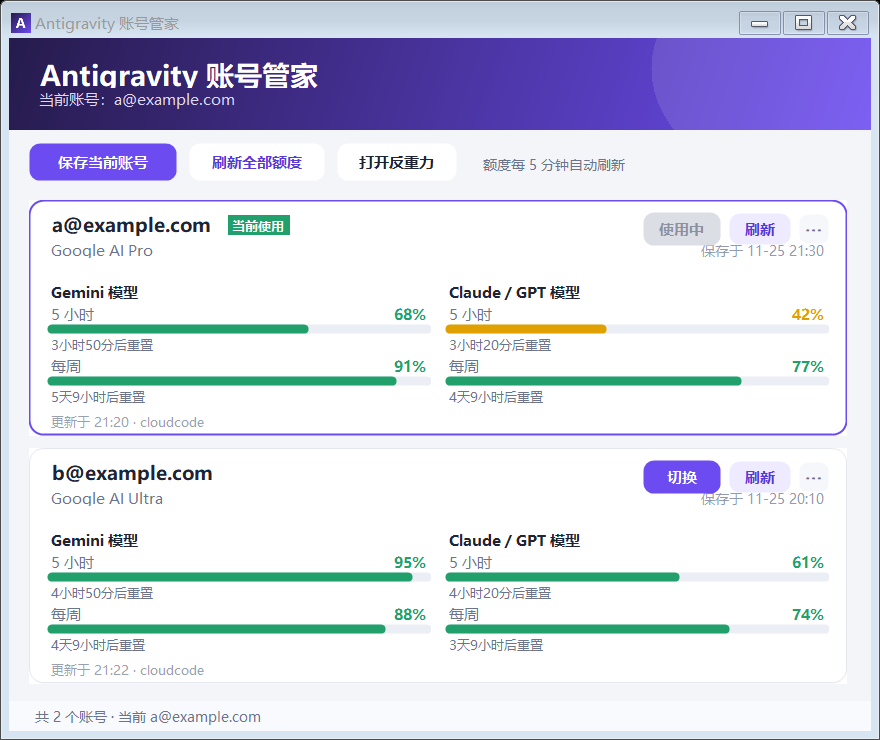

# Antigravity Account Manager

[简体中文](README.md) · Sign in once per account, then switch with one click — **no repeated Google sign-in**.

A Windows GUI for managing multiple Google Antigravity accounts, switching between them without re-authenticating, and checking remaining quota.

Also known as an Antigravity account switcher / multi-account manager.

## The problem it solves

Google Antigravity allows only one Google account to be active at a time. When the quota runs out, the official flow forces you to:

```
sign out → open a browser → choose another account → complete Google OAuth
→ wait for the callback → reopen your workspace
```

Doing this every time is slow, interrupts your work, and frequently selects the wrong Google account.

This tool saves each account's login token as a local snapshot. **Each account only needs to be signed in once.** After that, switch accounts from a card:

- close Antigravity
- restore the target account's token
- relaunch Antigravity

No browser is opened, no Google authorization flow is repeated, and the switch usually completes in seconds. Quota monitoring lives in the same window.

## Download

- [Latest release](https://github.com/sanmumu-325/antigravity-account-manager/releases/latest) (recommended, includes the exe)
- Or download `AntigravityAccountManager.exe` from the repository root

## Features

- Account cards with email, label, plan, and an “active” badge
- Quota dashboard for the Gemini and Claude/GPT groups, with 5-hour and weekly percentages plus reset countdowns
- One-click switching — saves the token snapshot, restarts Antigravity, and avoids repeated Google login
- Manual or automatic quota refresh every 5 minutes; cached results are shown on the next launch
- Rename, copy email, and delete local profiles from the `⋯` menu

Interface preview (sample data):



## Quick start

Double-click:

```
AntigravityAccountManager.exe
```

### First-time setup

1. Sign in to account A in Antigravity, then click **保存当前账号** (Save current account).
2. Sign out in Antigravity, sign in to account B, then save it too.
3. From now on, click **切换** (Switch) on a card; no browser login is required.

### Daily use

- **Switch** closes and relaunches Antigravity; unsaved work may be lost.
- **Refresh all quotas** uses each account's own OAuth token and does not require Antigravity to be signed in.
- **Open Antigravity** only launches the app without changing the active account.

## How quota data is fetched

The app reads locally saved OAuth tokens, refreshes the access token, and calls Google Cloud Code endpoints:

```
POST https://daily-cloudcode-pa.googleapis.com/v1internal:retrieveUserQuotaSummary
POST .../v1internal:loadCodeAssist
POST .../v1internal:retrieveUserQuota
POST .../v1internal:fetchAvailableModels
```

These are undocumented endpoints and may change after an Antigravity update. Values come from the API's `remainingFraction`; the 5-hour/weekly windows and reset times are reported as returned.

## Data and security

- Account snapshots: `%USERPROFILE%\.antigravity-switch\profiles\`
- Quota cache: `quota.json` inside each account folder
- Backups: `%USERPROFILE%\.antigravity-switch\backups\`
- Logs: `%USERPROFILE%\.antigravity-switch\logs\app.log`
- Tokens are equivalent to Google login credentials. Do not share this directory; keep your Windows account locked.
- The app only reads and writes tokens locally; there is no relay server.

## OAuth client credentials

This repository does **not** contain a Google OAuth client secret. When a token needs refreshing, the app reads credentials in this order:

1. `%USERPROFILE%\.antigravity-switch\oauth-clients.json` (private local override)
2. `resources\bin\language_server.exe` inside the installed Antigravity directory (automatically extracted)

If extraction fails, copy `oauth-clients.example.json` to the path above and fill in the client ID / secret used by your Antigravity build, then restart the app.

## Compatibility

- Windows 10/11 with .NET Framework 4.8
- Antigravity desktop 2.x token locations:
  - `%USERPROFILE%\.gemini\jetski-standalone-oauth-token`
  - `%USERPROFILE%\.gemini\antigravity-cli\antigravity-oauth-token`
  - Windows Credential Manager `gemini:antigravity` (shared by the desktop app and CLI)
- After an Antigravity update, sign in again once and save the account if the storage format changed.

## Known limitations

- Only one Antigravity account can be active at a time; switching restarts the client, so two accounts cannot be online simultaneously.
- Switching kills Antigravity and its language server. Save your work first.
- Newer desktop builds share `gemini:antigravity` with the `agy` CLI; switching also changes the CLI account.
- Quota endpoints are unofficial and may return 403/429 or only one model group. The app tries multiple endpoints and keeps the last cache.
- The executable is unsigned and may trigger SmartScreen. Source is in `src/`; build it yourself if preferred.
- Use only accounts you own and that are properly subscribed. Do not use automated rotation to abuse quotas.
- This project is not affiliated with Google.

## Troubleshooting

- **“No token found” after signing in**: use version 1.0.3+; the new desktop app stores credentials in Windows Credential Manager under `gemini:antigravity`.
- **access_token expired / refresh failed**: check that your proxy or VPN can reach Google. If a refresh token exists, refresh after the network recovers; re-login is not required.
- **Browser can open local sites but not Google**: if `127.0.0.1:7890` is mihomo/Clash, choose a working node or update the subscription, and enable system proxy or TUN mode.
- **Clash/Sparkle process-based routing**: add `PROCESS-NAME,AntigravityAccountManager.exe,<your-proxy-group>`. The existing `Antigravity.exe` rule does not match this manager; otherwise traffic falls through `MATCH,DIRECT`.

## Build

```powershell
cd <project-directory>
.\build.ps1
```

Uses the built-in `csc.exe`; no NuGet dependencies.

## Self-test

```powershell
.\AntigravityAccountManager.exe --selftest
Get-Content .\selftest.log
```
