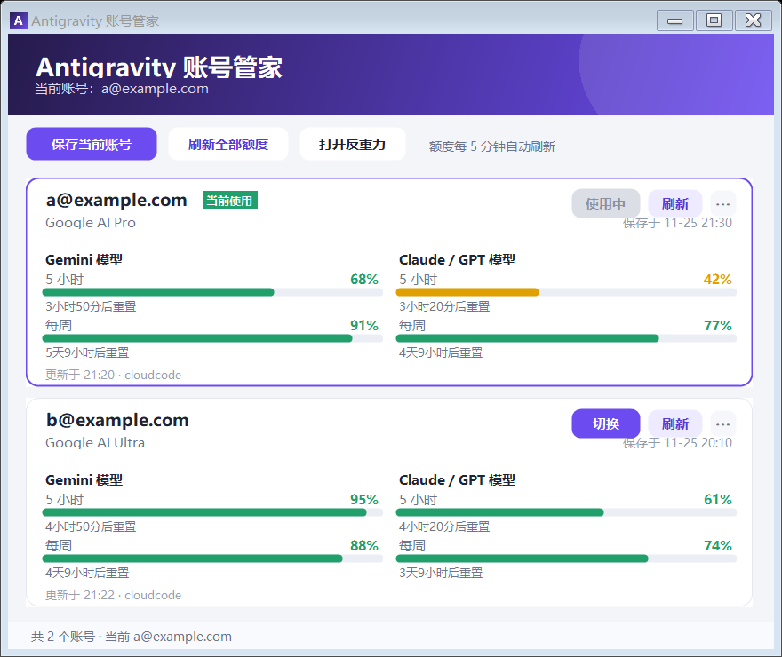

# Antigravity 账号管家

Windows 图形版账号切换器，给反重力（Google Antigravity）同时管理多个 Google 账号，并显示剩余额度。

## 下载

- [最新 Release](https://github.com/sanmumu-325/antigravity-account-manager/releases/latest)（推荐，含 exe）
- 或直接下载仓库根目录的 `AntigravityAccountManager.exe`

## 功能

- 账号卡片：邮箱、备注名、套餐、当前使用标记
- 额度面板：Gemini 与 Claude/GPT 两组，分别显示 5 小时、每周剩余百分比和重置倒计时
- 一键切换：保存每个账号的登录令牌，换号时自动关闭反重力、替换令牌并重新启动
- 额度刷新：手动刷新，或每 5 分钟自动刷新；刷新结果会缓存，下次打开先显示上次数据
- 备注/删除：卡片右上角 `⋯` 菜单可以重命名、复制邮箱、删除本机配置

界面预览（示例数据）：



## 直接使用

下载或自行编译后，双击：

```
AntigravityAccountManager.exe
```

或在项目目录用命令行启动：

```bat
AntigravityAccountManager.exe
```

### 第一次准备

1. 在反重力里登录账号 A，回到管家点 **保存当前账号**。
2. 在反重力里退出登录，登录账号 B，再点 **保存当前账号**。
3. 以后在卡片上点 **切换**，几秒完成换号，不再走网页登录。

### 日常

- **切换**：会关闭并重新启动反重力，未保存的对话/任务可能丢失。
- **刷新全部额度**：用每个账号自己的 OAuth 令牌查询，不需要反重力处于登录状态。
- **打开反重力**：只启动程序，不改变当前账号。

## 额度是怎么来的

程序读取本机保存的 OAuth 令牌，刷新 access_token 后调用 Google Cloud Code 的额度接口：

```
POST https://daily-cloudcode-pa.googleapis.com/v1internal:retrieveUserQuotaSummary
POST .../v1internal:loadCodeAssist
POST .../v1internal:retrieveUserQuota
POST .../v1internal:fetchAvailableModels
```

这是非公开接口，反重力官方升级后可能变化。额度数字以接口返回的 `remainingFraction` 为准，5 小时/每周窗口和重置时间均直接来自返回值。

## 数据与安全

- 账号快照：`%USERPROFILE%\.antigravity-switch\profiles\`
- 额度缓存：每个账号目录下的 `quota.json`
- 备份：`%USERPROFILE%\.antigravity-switch\backups\`
- 日志：`%USERPROFILE%\.antigravity-switch\logs\app.log`
- 令牌等同于 Google 登录凭据，目录不要分享给他人；建议保持 Windows 账户密码/锁屏。
- 程序只在本机读写令牌，不经过任何中转服务器。

## OAuth 客户端参数

仓库**不包含** Google OAuth client secret。需要刷新 access_token 时，程序按顺序读取：

1. `%USERPROFILE%\.antigravity-switch\oauth-clients.json`（本地私有配置，不随仓库分发）
2. 本机 Antigravity 安装目录下的 `resources\bin\language_server.exe`，自动提取客户端参数

如果自动提取失败（例如反重力换了安装方式），把 `oauth-clients.example.json` 复制到：

```
%USERPROFILE%\.antigravity-switch\oauth-clients.json
```

填入你自己 Antigravity 客户端对应的 `clientId` / `clientSecret`，重启管家即可。

## 兼容性

- Windows 10/11，需 .NET Framework 4.8（系统自带）
- 当前按反重力桌面端 2.x 的令牌位置适配：
  - `%USERPROFILE%\.gemini\jetski-standalone-oauth-token`
  - `%USERPROFILE%\.gemini\antigravity-cli\antigravity-oauth-token`
  - Windows 凭据管理器中的 `gemini:antigravity`（新版桌面端与 CLI 共用）以及名称含 `antigravity` / `jetski` 的条目
- 反重力升级后若登录存储变化，重新登录并点一次“保存当前账号”即可；接口或界面大改则可能需要更新程序。

## 已知限制

- 反重力同一时间只能登录一个账号，切换需要重启客户端，不能两个账号同时在线。
- 切换会强制结束反重力和语言服务，切换前先保存工作。
- 新版桌面端和 `agy` CLI 共用 `gemini:antigravity` 凭据；切换账号会同时改变 CLI 的登录账号。
- 额度接口不是公开 API，可能返回 403/429，或只返回 Claude/GPT 组；程序会尝试多个端点和 User-Agent，并保留上次缓存。
- 未签名 exe，首次运行可能触发 SmartScreen；源码在 `src/`，可自行编译核对。
- 两个账号都必须是自己的、正常付费/开通的账号；不要用自动轮换恶意绕过配额。

## 常见问题

- **点“保存当前账号”提示未登录**：确认运行的是 1.0.1 及以上版本；新版反重力把令牌放在 Windows 凭据管理器 `gemini:antigravity`，旧版程序只找 `jetski-standalone-oauth-token` 文件，因此会看不到。
- **额度显示 401**：保存的登录已过期，重新在反重力登录一次，再点“保存当前账号”。
- **提示 access_token 过期且自动续期失败**：先检查代理 / VPN 能否访问 Google。refresh_token 仍在时，网络恢复后点“刷新全部额度”即可，不需要重新登录。
- **浏览器能开国内站但 Google 打不开**：本机 `7890` 端口如果是 `mihomo` / Clash 在监听，说明代理核心在运行，但节点或订阅可能失效；换一个可用节点/更新订阅，并确认系统代理或 TUN 模式已开启。
- **用 Clash / Sparkle 按进程分流**：需要单独给 `AntigravityAccountManager.exe` 加代理规则（例如 `PROCESS-NAME,AntigravityAccountManager.exe,你的代理组`）。现有 `Antigravity.exe` 规则不会匹配管家，未匹配的流量会走最后的 `MATCH,DIRECT`。
- **保存成功但立即报额度失败**：保存只负责写账号快照；随后查询额度需要访问 Google。额度失败不会影响已保存的账号，网络恢复后刷新即可。
- **额度显示 403 / 空数据**：该账号的套餐或路由可能不返回对应模型组，或接口临时限制；稍后刷新，仍失败可把卡片上的错误文字发我。

## 命令行版本（备用）

`switch.ps1` / `switch.cmd` 仍保留，适合不开 GUI 时使用：

```bat
switch.cmd save a
switch.cmd save b
switch.cmd list
switch.cmd use a
switch.cmd status
```

## 自行编译

```powershell
cd <项目目录>
.\build.ps1
```

使用系统自带 `csc.exe` 编译，无 NuGet 依赖；生成 `AntigravityAccountManager.exe`。

## 自检

```powershell
.\AntigravityAccountManager.exe --selftest
Get-Content .\selftest.log
```
